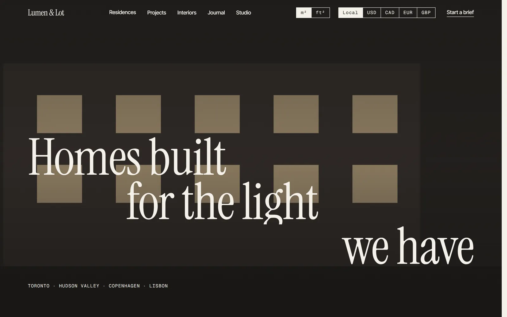
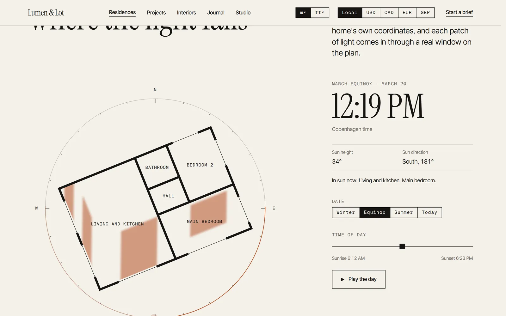
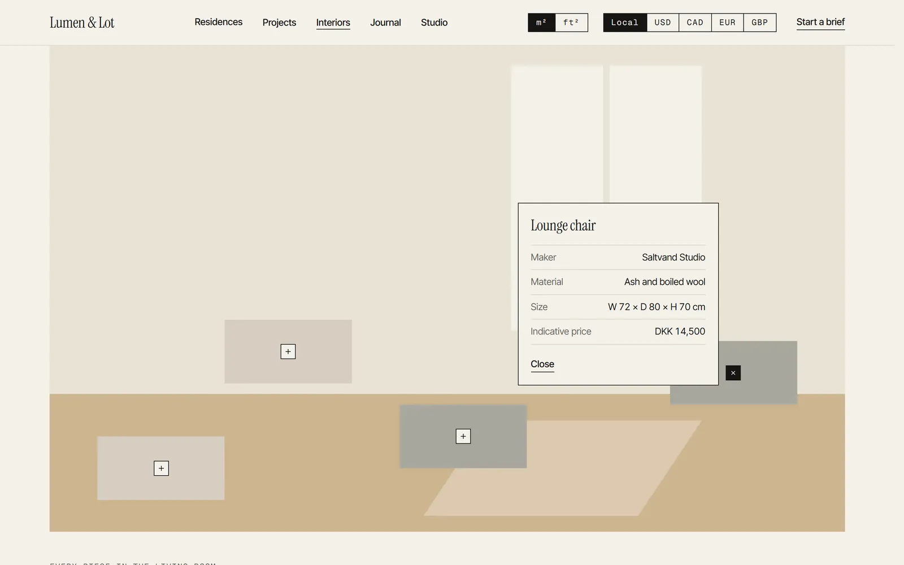
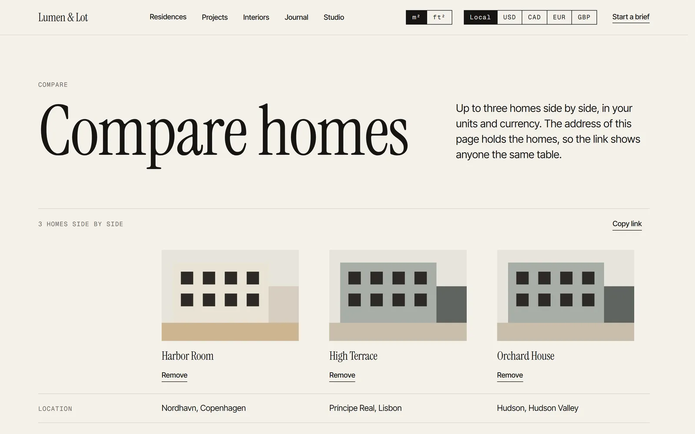
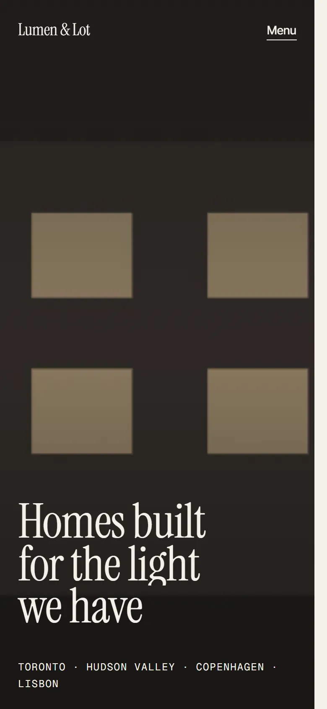
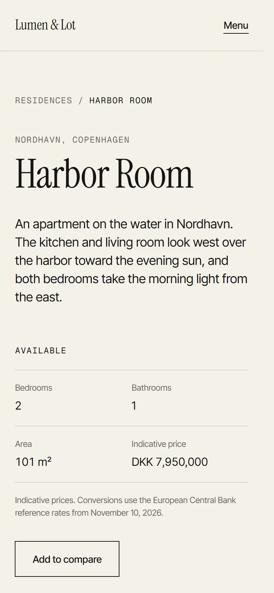

# Lumen & Lot

The website for Lumen & Lot, a fictional design-build studio that designs, builds and furnishes
small residential developments in Toronto, the Hudson Valley, Copenhagen and Lisbon. It is meant
to read like a printed monograph, not a store.

Lumen & Lot is a concept studio, designed and built by [Emmanuel Onugwu](https://emmanuelonugwu.com).
The homes, projects, people, prices, makers and awards are invented. The sun positions, the
exchange rates and the energy label systems are real.



## What is in it

- **Residences.** Six homes across four cities, in a grid or a list, with filters. Each home has
  a gallery, a floor plan, finishes, specifications and an energy label on its own country's
  scale.
- **Projects.** Four case studies with an editorial index, alternating story chapters, drawings
  and a before and after slider.
- **Interiors.** One lookbook per studio palette, with the pieces in each room.
- **Journal.** Three MDX articles with a drop cap, pull quotes, wide figures and a reading time
  worked out at compile time.
- **Studio and colophon.** How the studio works, and how the site was made.

### Signature features

**Daylight Explorer.** Sunlight moves across each floor plan for a chosen date and hour,
calculated with SunCalc from the home's real coordinates. Light enters only through windows that
face the sun, minus the shade of the window reveal. A table of rooms and their sun hours is the
text alternative.



**Palette Switcher.** Three interior palettes swap the room photos and the finishes list. The
choice lives in the URL, so it can be shared.

**Shop the Room.** Hotspots on interior photos are real buttons, named after the piece, that work
with a keyboard and a screen reader. Every piece is also listed below its photo.



**Compare and brief.** Up to three homes side by side, with a link to share. A six-step brief
validates each step and downloads as a PDF made in the browser. Nothing is sent anywhere.



<p>
  
  
</p>

## Stack

- **Next.js 16** with the App Router, Cache Components, Partial Prefetching, the React Compiler
  and typed routes. Server components by default.
- **React 19** and **TypeScript** in strict mode.
- **Tailwind CSS 4**, with every design token declared once in `app/styles/tokens.css`.
- **Zod** validates all content when it loads, so bad content fails the build.
- **MDX** for the journal, with a small remark plugin for reading time.
- **SunCalc** for sun positions, **React-pdf** for the brief, and **Lenis** for smooth scrolling.
- **Vitest** for logic, and **Playwright** with **axe** for pages.
- Hosted on **Vercel**.

## Design decisions

- **Tokens only.** Six colors, three typefaces, a fluid type scale and three motion durations.
  Raw hex and pixel values are blocked by ESLint outside `app/styles/`.
- **No flash on load.** Area unit, currency and view choices are copied onto `<html>` by a tiny
  head script before first paint. The server renders every variant and CSS shows the chosen one.
- **Light, modeled honestly.** A window lets sun in only when the sun is up, faces it and is not
  fully shaded by its reveal. The page says it shows direct sun on an open site.
- **Honest by design.** Every footer credits the concept. Prices are labelled indicative and
  converted at stated ECB rates. Energy labels stay in their own systems and are never ranked
  against each other. Forms say that nothing was sent.
- **Accessible first.** WCAG 2.2 AA: semantic landmarks, a skip link, native form controls,
  visible focus, text alternatives for the floor plans, and no motion when the system asks for
  less.
- **Calm motion.** Transitions are 200, 400 or 800 ms on one ease-out curve. Page changes use
  view transitions. Images reveal only below the fold, so they never delay the first paint.

The full list of decisions, phase by phase, is in [CLAUDE.md](CLAUDE.md).

## Quality

- **Tests.** Over 300 Vitest unit tests cover the sun model, units, currency, the brief, content
  validation and the SEO helpers. More than 140 Playwright tests run axe, check for console
  errors and sideways scrolling on every page, and walk through each feature by keyboard.
- **Lighthouse, mobile.** Median of three runs on a local production build:

  | Page                    | Performance | Accessibility | Best practices | SEO | LCP   | CLS |
  | ----------------------- | ----------- | ------------- | -------------- | --- | ----- | --- |
  | Home                    | 92          | 100           | 100            | 100 | 0.8 s | 0   |
  | Residence (Harbor Room) | 90          | 100           | 100            | 100 | 0.9 s | 0   |
  | Project (Stair House)   | 95          | 100           | 100            | 100 | 0.8 s | 0   |

  Performance moves between 88 and 96 from run to run. The rest is main-thread time while the
  framework starts up. A near-static page like the colophon scores in the same range, so that
  time is mostly the Next.js and React runtime rather than the site's own code.

## Getting started

Requires Node.js 24.

```bash
npm install
npx playwright install chromium
npm run dev
```

Set `SITE_URL` to the public origin in production. On Vercel the production domain is used
automatically.

## Scripts

| Command               | Purpose                                                       |
| --------------------- | ------------------------------------------------------------- |
| `npm run dev`         | Start the development server on port 3000                     |
| `npm run build`       | Build for production                                          |
| `npm run lint`        | Lint with ESLint                                              |
| `npm run typecheck`   | Generate route types and type-check                           |
| `npm test`            | Run unit tests with Vitest                                    |
| `npm run test:e2e`    | Run page, accessibility and layout tests with Playwright, axe |
| `npm run screenshots` | Capture every page at 375, 768 and 1440 pixels wide           |
| `npm run images`      | Draw a placeholder for every image the content references     |
| `npm run format`      | Format with Prettier                                          |

## Project structure

```text
app/                  routes, server components by default
  _seo/               metadata, Open Graph cards and structured data
components/ui/        primitives: Button, Label, Rule, Section, Drawer, Toggle…
components/features/  daylight, palette, shop-the-room, compare, brief
content/              typed, validated data: residences, projects, lookbooks, rates
content/journal/      MDX articles
lib/                  pure logic, unit tested: sun, units, currency, brief…
tests/                Vitest units and Playwright suites
docs/                 the build plan and the journal fact check
```

## Credits

Type: Instrument Serif by Instrument, Inter Tight by Rasmus Andersson and Geist Mono by Vercel,
all under the SIL Open Font License. Every image is a flat-tone placeholder drawn by
`npm run images`.
